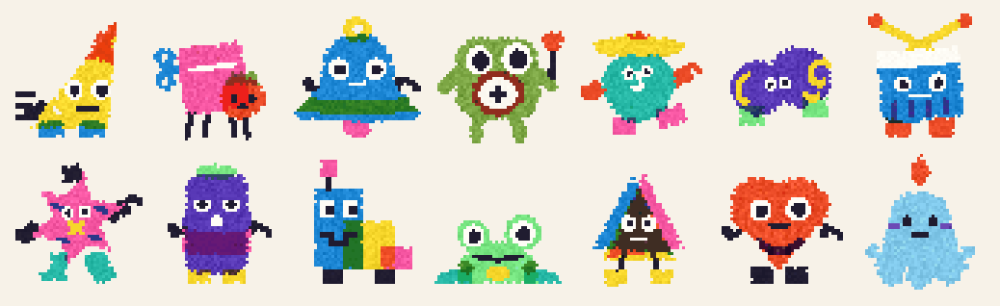

# TONEGAKKO — An Island of Sound (`0.47.0` Web)

Play **Tonegakko `0.47.0` Risograph Edition** directly in your browser — an island of musical creatures where you wake them up, mix their rhythms and moods, and discover 32 hidden styles to invite 14 new friends ashore. Features an **M8-inspired 5-Tab Live Visual Field Guide**, an **8-step core-gameplay discovery tutorial** with animated pointers and a live recipe coach, tactile Risograph horizontal slide bars across every sub-menu, an interactive Goal Book, all 5 Print Editions, real C99 synth engine, and 14 starter sounds compiled into a single WebAssembly bundle.

**Play live:** https://oodplex.github.io/tonegakko-brick-web/

## What's New in `0.47.0`
- **5-Tab Live Visual Field Guide (`? GUIDE` on Island & `MENU -> FIELD GUIDE`):** Modeled after interactive hardware field guides, built right inside the 1024×768 Risograph frame with real-time game/audio diagrams and 1-tap jump buttons:
  1. **`1 THE GAME`:** Live 4-stage connected flowchart reading your real band, pinned recipe chips, animated bar-dot progress, Era milestone road (`I. DUSK` -> `V. DAYBREAK`), and visual clue decoders (`Zzz`, singing rings, hint bubbles).
  2. **`2 SCREEN TOUR`:** Annotated miniature map of the Island screen with colored leader lines pointing straight at every bar, creature cue, and dock button (every callout clickable!), plus a visual guide to all **6 Sound Families** with real sprites.
  3. **`3 WHAT TO DO`:** 8 visual task cards explaining **what can be done** and **where to find each function** — each with a 1-tap **`GO >`** jump button straight into that tool!
  4. **`4 SOUND FLOW`:** Live 5-stage signal-flow schematic for the currently selected creature (`1. VOICE` -> `2. FILTER` curve -> `3. SHAPE` ADSR -> `4. MIX & FX` pan/sends -> `5. LIVE OUT` real-time oscilloscope!), plus visual Slide Bar vs Choice Pill decoders and live `WOBBLE (LFO)` & Euclidean `ARP` visualizers.
  5. **`5 ALL SCREENS`:** Interactive 4-column clickable map of all 13 Tonegakko rooms with plain-English "what it does" labels, live `HERE` highlight, and a split Touch/Mouse + Keyboard shortcut reference.
- **8-Step Core-Gameplay Discovery Walkthrough:** Teaches Tonegakko's real gameplay loop by playing through real discoveries — wake a creature & fill the dots for `FIRST LIGHT`, add drums to invite `WORMLE` (`HEARTH`), rest drums & drag a tune for `TIDECALL`, play 6 live notes on `KEYS` for `HUMALONG`, open `BOOK` to `PIN GOAL`, actively hunt & solve your pinned Book recipe live with smart yellow-chip pointers to unlock Style 5/32, sculpt a voice with `SOUND` slide bars, and head toward `DAYBREAK`!
- **Tactile Risograph Slide Bars Across All Sub-Menus:** Every draggable parameter renders as a real horizontal slide bar with a chunky draggable thumb handle; discrete pickers render as `v` Choice Pills.
- **Native-Feeling Phone Portrait Layout:** Edge-to-edge upright frame with a large readable Companion Strip above a clean touch dock.

## Controls

### Touch & Mouse (Inside the Frame)
- **Tap** a creature to pick it; tap again to wake it up or put it to sleep
- **Drag** a creature left/right for a new tune and up/down for pitch
- **Slide** any horizontal slide bar on `SOUND`, `SYNTH`, `ENV`, `WOBBLE`, `PATTERN`, `STEPS`, `FX`, `MIXER`, `GLOBAL`, `TEMPO / FX`, or `MENU` (Volume)
- **Tap** any `v` Choice Pill to pick from a clean grid (`VOICE`, `KEY`, `SCALE`, `WANDER`, `TONE`, `PRINT EDITION`, etc.)
- **Right-click** anywhere on the canvas to go back or close an open panel

### Desktop Keyboard
- **`Space`** / **`Enter`**: Play / Pause · **`↑ ↓ ← →`**: Move · **`Shift + ↑ ↓ ← →`**: Edit
- **`D F G H J K L ;`**: Play live scale notes (hold **`'`** for higher notes)
- **`[` / `]`**: Switch pages · **`Tab`** / **`S`**: Actions · **`Esc`**: Back · **`⌘Z` / `Ctrl+Z`**: Undo

### Gamepad & Saves
- **Gamepad:** Any USB or Bluetooth controller works automatically via the browser Gamepad API
- **Saves:** Islands, Guide progress, pinned Goals, Book discoveries, and Print Edition persist automatically in browser storage (IndexedDB)
